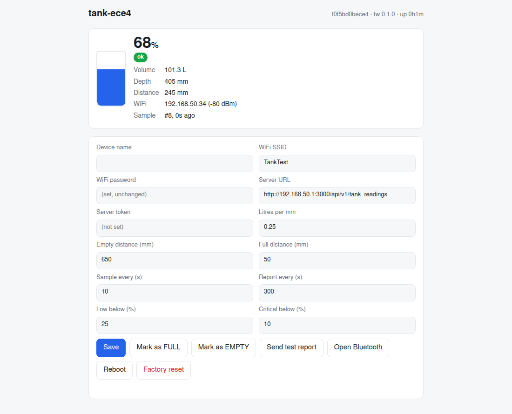
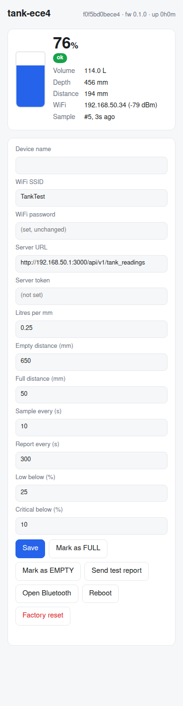
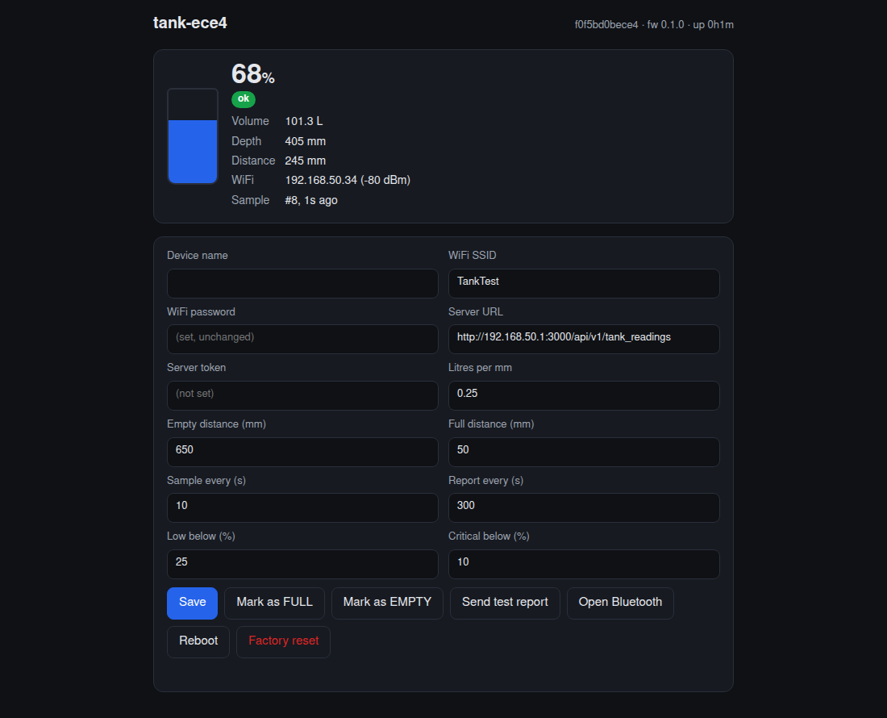

# Rabbit water tank level monitor (ESP32-C6, bare-metal Rust)

Measures the water level in a square drinker tank with a DFRobot **A02YYUW**
ultrasonic sensor, exposes it over **BLE** and a **local web UI**, and reports
to a Ruby on Rails farm-management app over plain HTTP on the LAN.

`no_std` / `no_main`: esp-hal + Embassy, no ESP-IDF C code. Design and
decisions: [`docs/ARCHITECTURE.md`](docs/ARCHITECTURE.md); server protocol:
[`docs/PROTOCOL.md`](docs/PROTOCOL.md).

## Layout

```
crates/tank-core/   hardware-independent logic (frame parser, median filter,
                    tank maths, level state machine, config + report types);
                    unit-tested on the host
src/main.rs         firmware entry: init, task wiring
src/app/            hardware tasks: storage, wifi, ble, web (+ index.html),
                    level sampler (real UART or simulator), reporter, control
tools/              BLE test scripts, test-hotspot configs
docs/               architecture proposal
```

## Status

| Area | State |
|---|---|
| Level pipeline | parser, filter, tank maths, state machine done; **simulated sensor** until the A02YYUW arrives (`sim-sensor` feature, on by default) |
| Config in flash | done (`nvs` partition, postcard via sequential-storage) |
| WiFi station | done; reconnects, scans while unprovisioned |
| BLE provisioning | done, tested end to end (see service table below); no pairing/PIN yet |
| Local web UI / JSON API | done, tested; no auth (LAN only) |
| Reporter | done: HTTP POST per [`docs/PROTOCOL.md`](docs/PROTOCOL.md), offline queue with byte-identical retries, server config + time applied from the reply; verified against the real Rails endpoint |
| Enrolment | done: zero-touch — device requests a token from the server, admin approves in the farm app; 403/401 handling, self re-enrol |
| OTA | not started (partition table still single `factory` app) |

## Screenshots

Local web UI served by the device (simulated sensor), desktop and phone:

<p>


</p>

Dark mode follows the browser setting:



## First-time WiFi setup from a phone

1. Install **nRF Connect for Mobile** (Android/iOS). The device advertises as
   `tank-xxxx` whenever it has no WiFi credentials.
2. Connect, open service `7a1e0001…`, write (UTF-8 text) the SSID to `…0002`,
   the password to `…0003`, optionally the server URL to `…0004`.
3. Write byte `01` to `…0009` (save + apply). Read `…0008` to see
   `"wifi":true`, the IP and `"srv":"pending"`.
4. The device enrols itself with the farm app; approve it there (it appears
   with this name and device id). Nothing else to type.
5. Open `http://<ip>/` on the same WiFi: the page above, with the WiFi fields
   in the form for later changes.

Known issue: while unprovisioned, BLE is only on air during the periodic WiFi
scans (see quirks below), so the phone may need a few scan attempts. A SoftAP
captive portal and mDNS are planned to make this smoother.

## Build, flash, monitor

Toolchain: rustup stable (≥1.95), target `riscv32imac-unknown-none-elf`,
`espflash`. Serial access needs the `dialout` group.

```sh
cargo build --release                      # simulated sensor
cargo build --release --no-default-features  # real A02YYUW on GPIO4
cargo run --release                        # flash + monitor (espflash)
cargo test -p tank-core --target x86_64-unknown-linux-gnu \
  --config 'unstable.build-std=["std","panic_abort"]'   # host unit tests
```

Build-time defaults for a freshly erased board (only used when flash holds no
config): `WIFI_SSID`, `WIFI_PASSWORD`, `API_URL` (API base, e.g. `http://10.10.1.16:3000/api/v1`), `API_TOKEN` (optional; normally the device enrols itself) environment variables.

Log level: `ESP_LOG` in `.cargo/esp-config.toml` (default `info`). For a
non-interactive capture: `stty -F /dev/ttyACM0 115200 raw -echo; timeout 30 cat /dev/ttyACM0`.

## Features

| Feature | Default | Effect |
|---|---|---|
| `sim-sensor` | on | simulated draining tank fed through the real frame parser |
| `ble-only` | off | diagnostic: no WiFi/web at all |

## Wiring (A02YYUW)

| Sensor | ESP32-C6 |
|---|---|
| VCC | 3V3 |
| GND | GND |
| TX | GPIO4 (UART1 RX) |
| RX | 3V3 (processed-value mode) |

BOOT button (GPIO9): press to open the BLE window.

## BLE service `7a1e0001-5a7e-4a6b-9b0e-2b4c6d8e0f10`

Advertised as the configured name or `tank-<last 4 of MAC>` for 5 min after
boot, on button press, and permanently while no WiFi SSID is set.

| UUID suffix | type | access | content |
|---|---|---|---|
| `…0002` | utf8 ≤32 | R/W | WiFi SSID |
| `…0003` | utf8 ≤64 | W | WiFi password |
| `…0004` | utf8 ≤128 | R/W | API URL |
| `…0005` | utf8 ≤64 | W | API token |
| `…0006` | 8 B LE | R/W | `empty_mm u16, full_mm u16, litres_per_mm f32` |
| `…0007` | 6 B LE | R/W | `sample_s u16, report_s u16, low_pct u8, critical_pct u8` |
| `…0008` | utf8 JSON ≤160 | R/notify | live status |
| `…0009` | u8 | W | 1 save+apply, 2 reboot, 3 calibrate full, 4 calibrate empty, 5 factory reset, 6 test report, 7 re-enrol |

## HTTP API (port 80)

| Method | Path | Body / result |
|---|---|---|
| GET | `/` | single-page UI |
| GET | `/api/status` | live level, state, network |
| GET | `/api/config` | config with secrets masked |
| POST | `/api/config` | partial JSON (`ConfigPatch`), persists, reconnects WiFi if credentials changed |
| POST | `/api/command` | `{"command":"reboot\|calibrate_full\|calibrate_empty\|factory_reset\|test_report\|ble\|enroll\|save\|save_reconnect"}` |

## Report payload

See [`docs/PROTOCOL.md`](docs/PROTOCOL.md) for the full request/response
contract. A report looks like:

```json
{"device_id":"f0f5bd0bece4","boot_id":1810345540,"seq":3,"fw":"0.1.0","uptime_s":46,"rssi":-79,
 "level":{"distance_mm":196,"depth_mm":444,"percent":75.9,"litres":133.2,"state":"ok","event":null},
 "sampled_at_uptime_s":41,"sampled_at":1793465985}
```

## Known quirks (esp-radio 1.0.0-beta.1, ESP32-C6)

* With WiFi+BLE coexistence, **BLE does not transmit while the WiFi driver is
  idle**. The firmware therefore scans WiFi every 20 s while unprovisioned.
  Once connected, BLE advertises continuously.
* **WiFi power save is off.** With `PowerSaveMode::Minimum` the device stopped
  receiving frames from the test AP (and BLE went silent). Revisit on the real
  AP with a current measurement.
* The device does not answer ICMP ping (no ICMP socket); use HTTP to probe.
* **Open issue:** after running unprovisioned (BLE + periodic WiFi scans) for
  several hours the device went silent on both serial and BLE once. Under
  investigation with a long serial capture.
